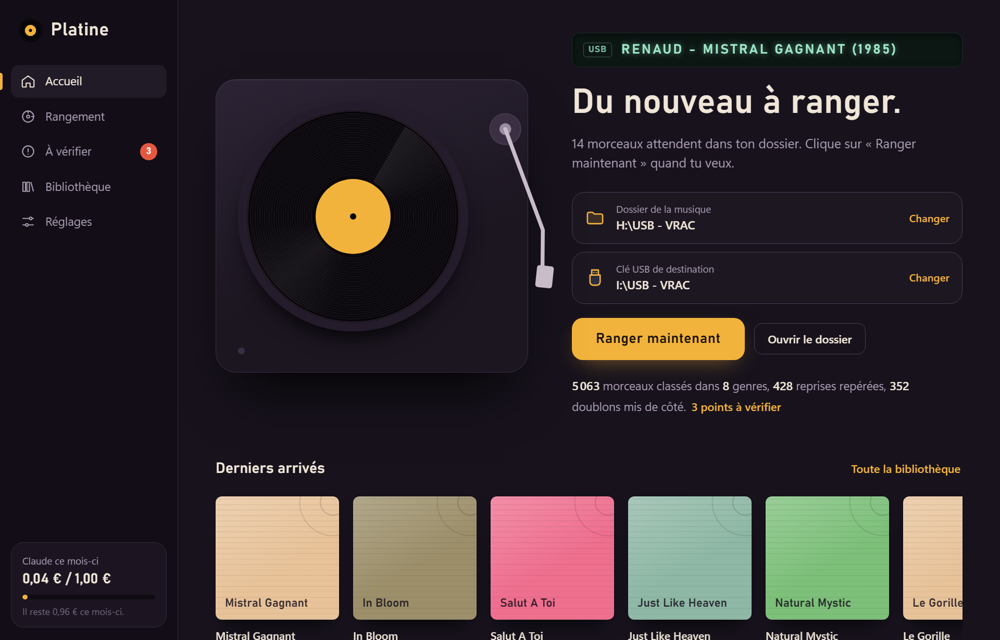
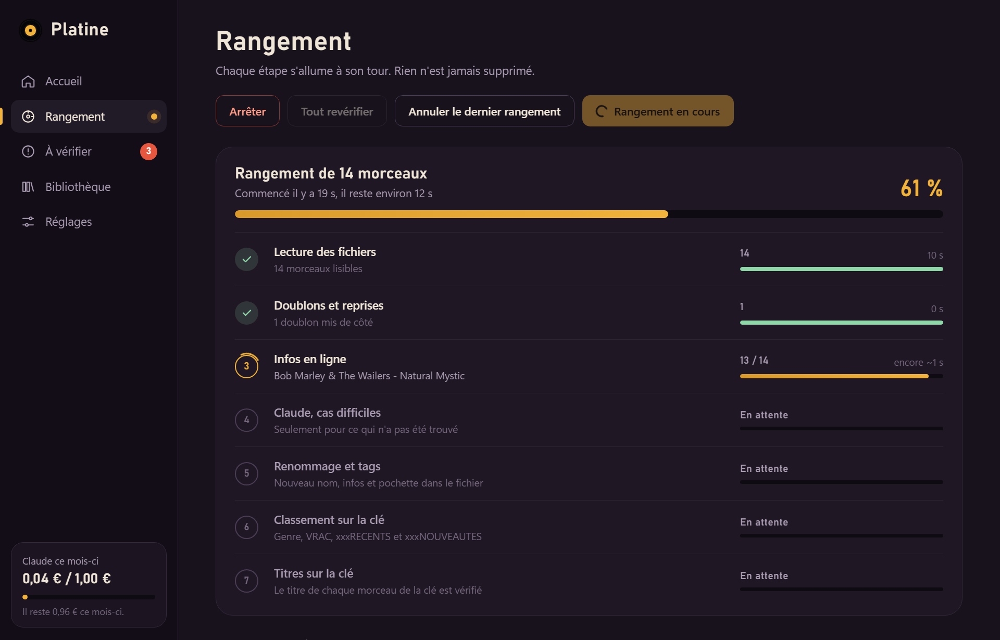

<div align="center">


# Platine

**Ta musique en vrac, rangée toute seule.**

Logiciel Windows qui transforme un dossier de MP3 mal nommés en bibliothèque propre :
noms corrigés, années, albums, pochettes, doublons écartés, classement par genre,
jusque sur une clé USB prête pour l'autoradio.

[](https://github.com/VBL33k/platine/releases/latest)


[**Télécharger l'installeur**](https://github.com/VBL33k/platine/releases/latest)

</div>

<p align="center">
  
</p>

## Pourquoi

Platine a été écrit pour une seule personne : un passionné de musique, pas du tout informaticien,
avec des milliers de morceaux récupérés au fil des années. `03 - the cure - lullaby.mp3`,
`RENAUD_-_Mistral gagnant.mp3`, des pochettes de compilations, des doublons partout,
et un autoradio qui affiche n'importe quoi.

Le logiciel devait donc :

- **ne jamais rien supprimer** : les doublons sont mis de côté, chaque rangement peut être annulé ;
- **ne jamais agir tout seul** : rien ne bouge tant qu'on n'a pas cliqué sur « Ranger maintenant » ;
- **demander plutôt que se tromper** : les rares cas douteux vont dans « À vérifier » ;
- **se mettre à jour sans aide** : les nouvelles versions s'installent en un clic.

## Ce que fait un rangement

<p align="center">
  
</p>

| Étape | Ce qui se passe |
|---|---|
| **Lecture** | Artiste et titre lus dans le nom ou les tags, même mal écrits (`01-artiste-titre`, underscores, MAJUSCULES, encodage cassé). Analyse des aigus pour repérer les faux 320 kbps. |
| **Doublons** | Même artiste, même titre, même version : le meilleur fichier reste, l'autre part dans `Doublons\`. Un live ou un remix n'est jamais pris pour un doublon. |
| **Infos en ligne** | Année, album et pochette via Deezer et MusicBrainz (gratuits). Les pochettes de compilations sont remplacées par celle du vrai album. |
| **Claude** | Seulement pour ce qui reste introuvable : année, genre, reprise ou pas. Appels groupés, recherche web uniquement en dernier recours, plafond mensuel. |
| **Renommage et tags** | `Artiste - Titre (Version) (Année).mp3`. Tags ID3v2.3 lisibles par les autoradios : titre complet, artiste, album, année, genre, pochette 500×500. |
| **Classement** | Copie dans le dossier du genre, et dans `Cover\` pour les reprises. |

### Mode clé USB

On choisit un dossier de départ et une clé USB déjà organisée. Platine renomme les morceaux du
dossier, puis copie chacun d'eux sur la clé :

```
CLÉ USB
├── PUNK UK / PUNK US / GOTH / HARD ROCK / …   dossier du genre (artistes étrangers)
├── FRANCAIS/CHANSON, FRANCAIS/RAP, …          artistes français et francophones
├── COVER/                                     les reprises, en plus
├── VRAC/                                      tous les morceaux
├── xxxRECENTS/                                sortis en 2020 ou après
└── xxxNOUVEAUTES/                             les derniers ajouts, à vider soi-même
```

- Un artiste déjà présent sur la clé rejoint le dossier où sont ses autres morceaux.
- Pour un nouvel artiste, Claude choisit parmi les dossiers existants (pays, langue, style).
  Sans Claude, c'est le genre trouvé en ligne et le pays MusicBrainz qui décident.
- Un morceau déjà sur la clé n'est jamais recopié.
- Le titre écrit dans chaque fichier de la clé est vérifié et corrigé si besoin.

## Installation

1. Télécharger **`Installer.Platine.exe`** depuis la [dernière version](https://github.com/VBL33k/platine/releases/latest).
2. Double-cliquer, puis **Installer** : pas besoin d'être administrateur.
3. Choisir le dossier de la musique, éventuellement la clé USB, puis **Ranger maintenant**.

Les mises à jour sont détectées au démarrage et s'installent en un clic : musiques, bibliothèque
et réglages sont conservés.

### Clé Claude (facultative)

Sans clé, tout fonctionne : les cas difficiles vont simplement dans « À vérifier ».
Avec une clé de la [console Anthropic](https://console.anthropic.com), Platine résout seul la
plupart de ces cas. Un plafond mensuel (1 € par défaut) est réglable dans Platine. La clé est
gardée dans le coffre-fort de Windows, jamais en clair.

## Développement

```bash
python -m venv .venv
.venv\Scripts\pip install pywebview mutagen pillow keyring anthropic numpy miniaudio pyinstaller
.venv\Scripts\python Platine.pyw            # lancer depuis les sources
.venv\Scripts\python Platine.pyw --debug    # avec les outils de développement web
.venv\Scripts\python build.py               # fabriquer dist\Installer Platine.exe
.venv\Scripts\python publier.py 1.3.0 "Ce qui change"   # build + publication de la version
```

Aperçu de l'interface dans un navigateur, avec des données d'exemple :
`python -m http.server -d web` puis `http://localhost:8000/index.html?apercu`.

| Dossier | Contenu |
|---|---|
| `platine/pipeline.py` | Le moteur de rangement, étape par étape, et l'annulation |
| `platine/naming.py` | Lecture et mise en forme des noms de fichiers |
| `platine/usbkey.py` | Classement sur une clé USB organisée |
| `platine/lookup.py` | Deezer et MusicBrainz |
| `platine/ai.py` | Claude, groupage des questions et plafond de dépense |
| `platine/tags.py`, `quality.py` | Tags, pochettes, analyse de la qualité audio |
| `platine/db.py` | Base SQLite : bibliothèque, artistes connus, journal d'annulation |
| `web/` | Interface (HTML, CSS, JavaScript), affichée par pywebview |

Réglages, base et journal sont dans `%APPDATA%\Platine\`. Le guide d'utilisation détaillé est dans
[LISEZ-MOI.md](LISEZ-MOI.md).
